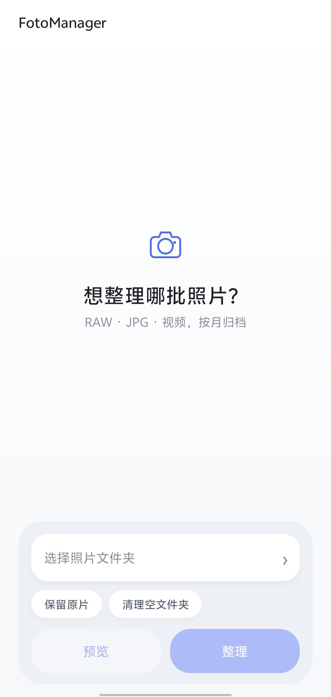

<p align="center"></p>

<h1 align="center">FotoManager</h1>

<p align="center">本地优先的 Android 照片/视频整理工具</p>

<p align="center">
  
  
  
</p>



FotoManager 把手机相册按 **RAW / JPG** 分类，按 **月份** 归档，并按拍摄时间重命名。
视频单独放在 `VIDEO/` 下，再分 RAW 视频和普通视频。

所有操作都在手机本地完成，APK **没有申请联网权限**。

## 功能

- RAW / JPG 分开存放，照片按 `YYYY-MM` 分月
- 视频单独归档：`VIDEO/RAW/YYYY-MM`、`VIDEO/NORMAL/YYYY-MM`
- 按拍摄时间重命名为 `yyyyMMdd HH-mm-ss`
- RAW + JPG 同名配对，改名后仍保持同名
- XMP / AAE / RMD 等边车文件跟随主文件一起改名
- 预览时显示缩略图、新文件名和原文件名
- 支持复制（保留原片）和移动两种模式
- 整理后可撤销；撤销记录只存在内存，不写日志文件
- 默认不清理空文件夹，需要时手动开启
- 不覆盖已有文件；同名自动加 `_2`、`_3`

## 下载与安装

从 [Releases](../../releases/latest) 下载最新 `FotoManager.apk`。

Android 8.0 及以上；安装时需要允许「安装未知应用」。

## 使用

1. 首次打开没有默认文件夹，点底部 **选择照片文件夹**
2. 点 **预览**，只读，不改任何文件
3. 确认统计和改名列表后，点 **整理**
4. 需要还原时点 **撤销上次**

整理后的目录示例：

```text
DCIM/
├── RAW/
│   └── 2026-05/
│       └── 20260512 14-30-01.cr2
├── JPG/
│   └── 2026-05/
│       └── 20260512 14-30-01.jpg
└── VIDEO/
    ├── RAW/
    │   └── 2026-05/
    │       └── 20260512 14-30-01.nev
    └── NORMAL/
        └── 2026-05/
            └── 20260512 14-30-01.mp4
```

## 时间优先级

- 照片：EXIF `DateTimeOriginal` → 文件名中的日期 → 文件修改时间
- 视频：视频元数据创建时间 → 文件名 → 文件修改时间
- RAW + JPG 配对时使用更可信的时间，保证改名后仍然同名
- Nikon N-RAW `.NEV`、ProRes RAW `.MOV` 会归入 RAW 视频

## 权限与安全

- Android 11+ 需要「所有文件访问」权限；Android 8–10 使用传统存储权限
- 没有 `INTERNET` 权限，照片和视频不会离开手机
- `allowBackup=false`，不备份图库数据
- 不写撤销日志；关闭 App 后撤销记录消失
- 默认先预览，确认后才修改文件
- 目标文件已存在时失败而不是覆盖
- 清理空文件夹默认关闭

## 从源码构建

环境：JDK 17、Android build-tools 34、platform android-34。

```bash
export ANDROID_SDK=/path/to/android-sdk
export KS_PASS='你的签名密码'
# 可选：export KEYSTORE=/path/to/your-release.keystore
./build.sh
```

首次运行且 `KEYSTORE` 不存在时，脚本会用 `KS_PASS` 生成本地 keystore。
**不要把 keystore 或密码提交到 Git**；丢失 keystore 后无法给已安装的 App 发同签名更新。

运行核心测试：

```bash
javac -encoding UTF-8 -d /tmp/core-classes \
  app/src/com/dsh/photoorganizer/PhotoOrganizer.java tests/CoreTest.java
java -cp /tmp/core-classes CoreTest
```

## 已知限制

- HEIC/HEIF、PNG、CinemaDNG 序列默认跳过
- ARRIRAW 等 `.mxf` 目前按普通视频处理
- 大相册首次扫描需要一点时间
- 撤销不落盘，App 被系统回收或手动关闭后无法撤销
- 8K 视频缩略图在部分机器上可能因内存不足而显示占位符
- 部分定制系统会把「所有文件访问」放在「特殊权限」里

## 说明

这是个人工具项目，不是应用商店版本；APK 使用自签名证书，安装时需要允许未知来源。
