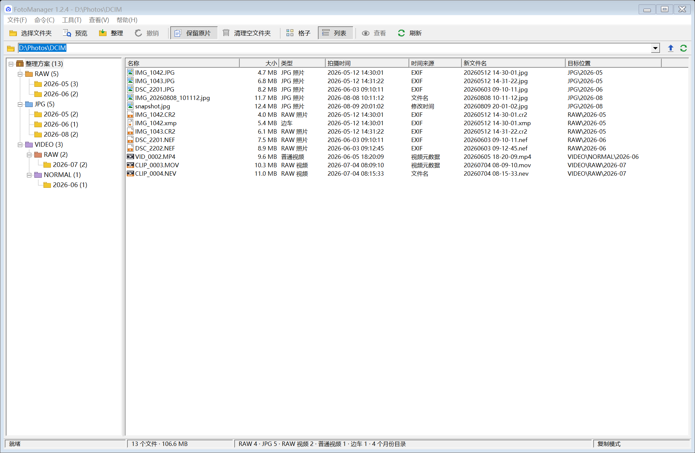
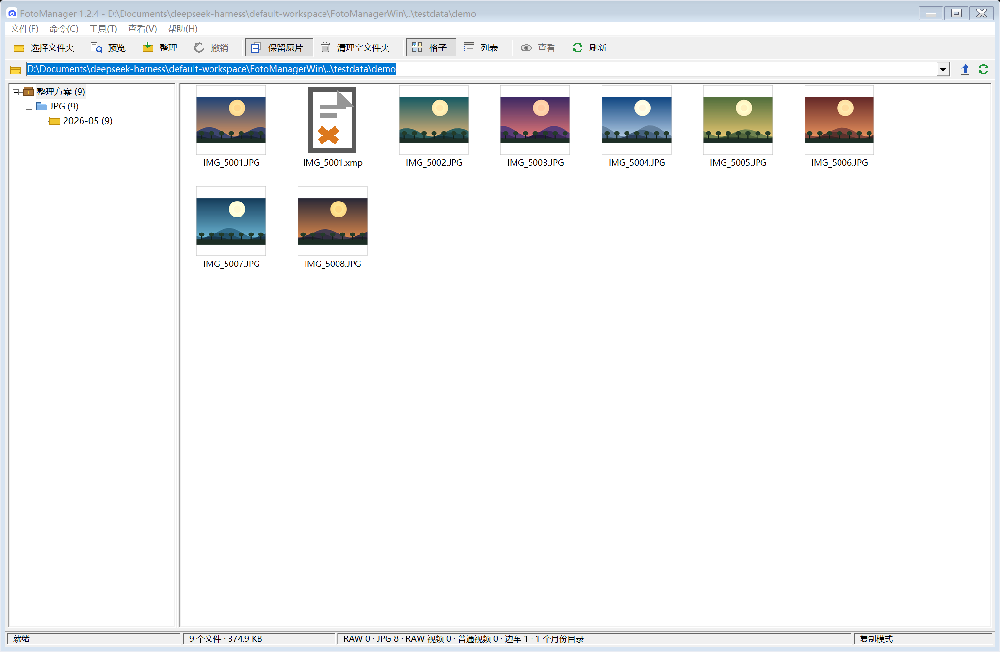

# FotoManager

本地优先的照片 / 视频整理工具，提供 Windows 桌面版和 Android 版。

Windows 版是 C# / WinForms 独立重写版：经典桌面工具界面、菜单栏、图标工具栏、地址栏、文件夹树、详细信息列表和状态栏。Android 版为原 1.1.6。

## 下载

| 平台 | 版本 | 下载 |
| --- | --- | --- |
| Windows | 1.2.4 | [FotoManager-1.2.4-win.zip](https://github.com/meteorr86/FotoManager/releases/tag/v1.2.4) |
| Android | 1.1.6 | [FotoManager.apk](https://github.com/meteorr86/FotoManager/releases/tag/v1.1.6) |

Windows 压缩包内含 `FotoManager.exe` 和使用说明；也可以从 Release 页面单独下载 EXE。

## Windows 版功能

- 可选择任意文件夹或磁盘根目录，不限于图片目录
- 两种视图：格子（JPG 缩略图）、列表（详细信息列），工具栏按钮一键切换
- 按 RAW / JPG / 视频分类，按拍摄月份归档
- 归档结构：`RAW\YYYY-MM`、`JPG\YYYY-MM`、`VIDEO\RAW\YYYY-MM`、`VIDEO\NORMAL\YYYY-MM`
- 按拍摄时间重命名：`yyyyMMdd HH-mm-ss`
- RAW + JPG 同名配对；XMP / AAE / RMD / DOP / PP3 / ON1 / COS 边车跟随改名
- EXIF / MP4-MOV 元数据 / 文件名 / 修改时间四级时间回退
- ProRes RAW（`aprn`）与 N-RAW / BRAW / R3D 归入 RAW 视频
- 复制（保留原片）和移动两种模式
- 预览、进度窗口、完成报告、内存内撤销
- 目标已存在自动 `_2`、`_3`，绝不覆盖
- 可清理空文件夹，不跟随符号链接，不碰隐藏/系统文件
- 高 DPI 感知，按显示器缩放比例自动放大布局和图标

## Windows 版使用

1. 解压后打开 `FotoManager.exe`
2. 点「选择文件夹」，选择任意文件夹或磁盘根目录
3. 点「预览」核对统计、新文件名和目标位置
4. 点「整理」执行；完成后可「撤销」

系统要求：Windows 10 / 11（64 位），.NET Framework 4.8。

## Android 版

Android 版当前为 1.1.6，可把手机相册按 RAW / JPG 分类、按月份归档，视频单独放到 `VIDEO/RAW` 和 `VIDEO/NORMAL`，并按拍摄时间重命名。

- [下载 FotoManager.apk](https://github.com/meteorr86/FotoManager/releases/download/v1.1.6/FotoManager.apk)
- [Android 版说明](android/README.md)

## 已知限制

- HEIC / HEIF、PNG、CinemaDNG 序列默认跳过
- CR3 等部分 RAW 容器中的 EXIF 可能读取不到，此时退回文件名或修改时间
- 视频只解析 MP4 / MOV 系列的容器元数据；`.mts` / `.m2ts` / `.mkv` / `.avi` / `.wmv` 等退回文件名或修改时间
- 格子视图只为 JPG 生成缩略图；RAW 照片、RAW 视频、普通视频和边车文件显示类型图标
- 撤销记录只在内存中，关闭程序后失效
- Windows 程序未签名，首次运行可能触发 SmartScreen：点「更多信息」→「仍要运行」

## 说明

- 所有处理都在本机 / 手机本地完成，不联网、不上传
- 不覆盖已有文件；目标重名时自动追加 `_2`、`_3`
- Windows 设置可通过环境变量 `FOTOMANAGER_HOME` 重定向，便于便携使用
- Windows 版与 Android 版说明分别在 `windows/README.md` 和 `android/README.md`

## 截图

### Windows

### Android

