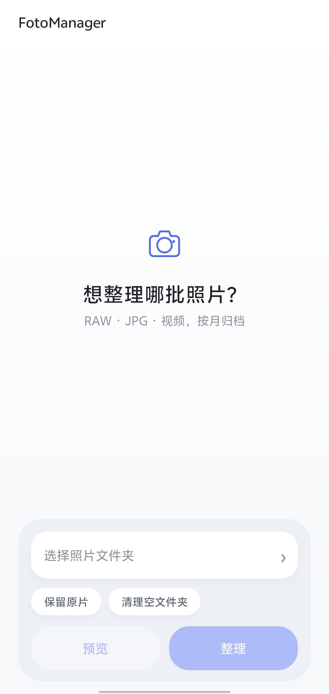

# FotoManager for Android

[Windows 版](../windows/README.md)

本地优先的 Android 照片/视频整理工具，当前版本 1.1.6。

## 下载

- [FotoManager.apk](https://github.com/meteorr86/FotoManager/releases/download/v1.1.6/FotoManager.apk)
- [Release 页面](https://github.com/meteorr86/FotoManager/releases/tag/v1.1.6)



## 功能

- 把手机相册按 RAW / JPG 分类，按月份归档
- 视频单独归档到 `VIDEO/RAW/YYYY-MM` 和 `VIDEO/NORMAL/YYYY-MM`
- 按拍摄时间重命名为 `yyyyMMdd HH-mm-ss`
- RAW + JPG 同名配对；XMP / AAE / RMD 等边车文件跟随改名
- 预览时显示分类统计和新文件名
- 支持复制（保留原片）和移动两种模式
- 撤销记录只在内存中，不写日志文件
- 目标文件已存在时自动加 `_2`、`_3`，不覆盖原文件

## 安装

- Android 8.0 及以上
- 从 Release 下载 `FotoManager.apk`
- 安装时允许安装未知来源应用

## 使用

1. 首次打开默认文件夹，底部点「选择相册文件夹」
2. 点「预览」，只查看，不改动任何文件
3. 确认统计和改名列表后，点「整理」
4. 需要还原时点「撤销上次整理」

整理后的目录示例：

```text
DCIM/
├── RAW/
│   └── 2026-05/
│       └── 20260512 14-30-01.cr2
├── JPG/
│   └── 2026-05/
│       └── 20260512 14-30-01.jpg
└── VIDEO/
    ├── RAW/
    │   └── 2026-05/
    │       └── 20260512 14-30-01.nev
    └── NORMAL/
        └── 2026-05/
            └── 20260512 14-30-01.mp4
```

## 时间优先级

- 照片：EXIF `DateTimeOriginal` → 文件名中的日期 → 文件修改时间
- 视频：视频元数据创建时间 → 文件名 → 文件修改时间
- RAW + JPG 配对时使用更可靠的时间，保证两者仍然同名
- Nikon N-RAW `.NEV`、ProRes RAW `.MOV` 归入 RAW 视频

## 权限与安全

- Android 11+ 需要授予文件夹访问权限；Android 8–10 使用传统存储权限
- 没有 `INTERNET` 权限，照片和视频不会离开手机
- `allowBackup=false`，不备份缩略图缓存
- 撤销记录只在内存中，关闭 App 后失效
- 默认先预览，确认后才修改文件
- 目标文件已存在时失败而不是覆盖
- 清理空文件夹默认关闭

## 已知限制

- HEIC/HEIF、PNG、CinemaDNG 序列默认跳过
- ARRIRAW 等 `.mxf` 目前按普通视频处理
- 大相册首次扫描需要一些时间
- 撤销不写入磁盘，App 被系统回收或手动关闭后无法撤销
- 8K 视频缩略图在部分手机上可能因内存不足显示占位图
- 若手动改了系统相册权限，需要在系统设置里重新授权

## 说明

这是个人工具，使用自签名证书，安装时需要允许未知来源。
