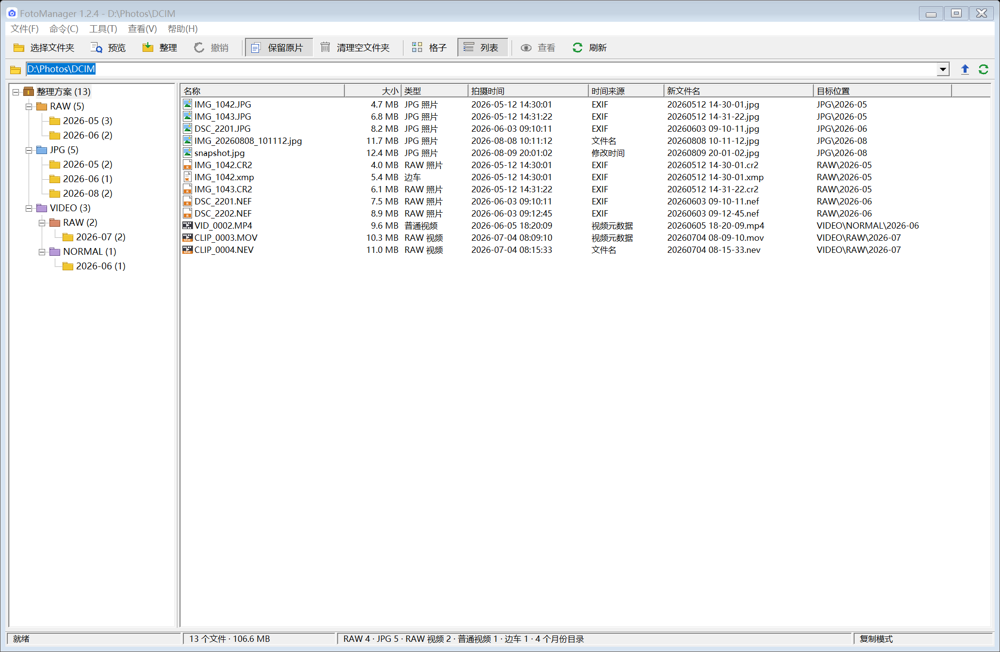
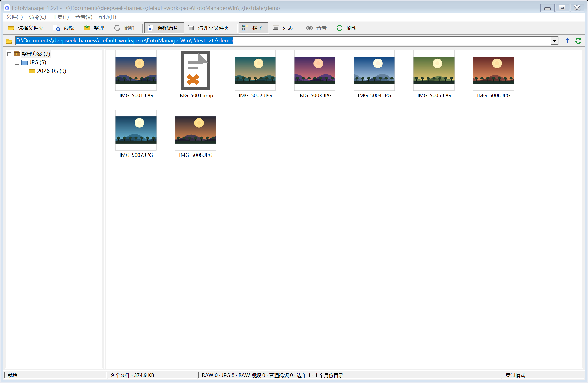

# FotoManager for Windows

本地优先的照片/视频整理工具，Android 版 FotoManager 1.1.6 的独立 Windows 重写版。

## 下载

- [FotoManager-1.2.5-win.zip](https://github.com/meteorr86/FotoManager/releases/download/v1.2.5/FotoManager-1.2.5-win.zip) — 推荐，包含 EXE 和使用说明
- [FotoManager.exe](https://github.com/meteorr86/FotoManager/releases/download/v1.2.5/FotoManager.exe) — 单文件版

[Release 页面](https://github.com/meteorr86/FotoManager/releases/tag/v1.2.5)

## 系统要求

- Windows 10 / 11（64 位）
- .NET Framework 4.8
- 不需要安装，不联网

## 功能

- 可选择任意文件夹或磁盘根目录，不限于图片目录
- 两种视图：格子（JPG 缩略图）、列表（详细信息列），工具栏一键切换
- 按 RAW / JPG / 视频分类，按拍摄月份归档
- 归档结构：`RAW\YYYY-MM`、`JPG\YYYY-MM`、`VIDEO\RAW\YYYY-MM`、`VIDEO\NORMAL\YYYY-MM`
- 按拍摄时间重命名：`yyyyMMdd HH-mm-ss`
- RAW + JPG 同名配对；XMP / AAE / RMD / DOP / PP3 / ON1 / COS 边车跟随改名
- EXIF / MP4-MOV 元数据 / 文件名 / 修改时间四级时间回退
- ProRes RAW（`aprn`）与 N-RAW / BRAW / R3D 归入 RAW 视频
- 复制（保留原片）和移动两种模式
- 预览、进度窗口、完成报告、内存内撤销
- 目标已存在自动 `_2`、`_3`，绝不覆盖
- 可清理空文件夹，不跟随符号链接，不碰隐藏/系统文件
- 高 DPI 感知，按显示器缩放比例自动放大布局和图标

## 使用

1. 打开 `FotoManager.exe`
2. 点「选择文件夹」，选择任意文件夹或磁盘根目录
3. 点「预览」核对统计、新文件名和目标位置
4. 点「整理」执行；完成后可「撤销」

## 已知限制

- HEIC/HEIF、PNG、CinemaDNG 序列默认跳过
- CR3 等部分 RAW 容器中的 EXIF 可能读取不到，此时退回文件名或修改时间
- 只解析 MP4/MOV 系列视频的容器元数据；`.mts` / `.m2ts` / `.mkv` / `.avi` / `.wmv` 等退回文件名或修改时间
- 格子视图只为 JPG 生成缩略图；RAW 照片、RAW 视频、普通视频和边车文件显示类型图标
- 撤销记录只在内存中，关闭程序后失效

## 说明

- 程序不联网，不写撤销日志
- 设置可通过环境变量 `FOTOMANAGER_HOME` 重定向，便于便携使用
- 程序未签名，首次运行可能触发 Windows SmartScreen：点「更多信息」→「仍要运行」

## 截图

